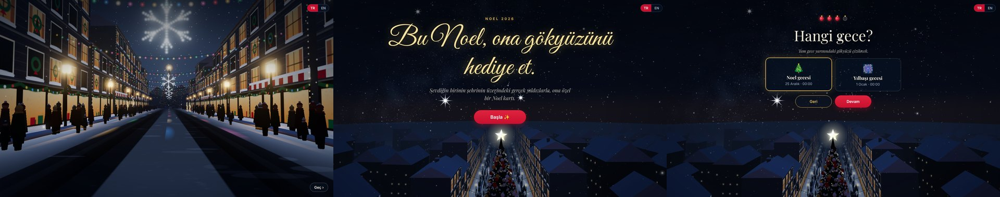
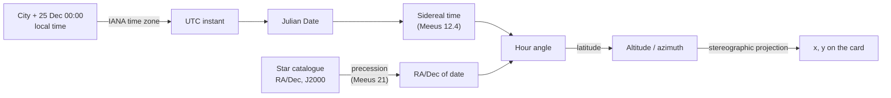

<h1 align="center">✨ Starry Christmas</h1>

<p align="center">
  <b>A Christmas card with the real night sky over your city at midnight — above a snowy forest where a sleigh is waiting.</b><br>
  <i>Şehrinin üzerindeki gerçek gökyüzü, Noel gecesi tam gece yarısı — kızağın beklediği karlı bir ormanın üstünde.</i>
</p>

<p align="center">
  <a href="https://sayko89.github.io/starry-christmas/"><b>▶ Make a card</b></a> &nbsp;·&nbsp;
  <a href="#how-the-sky-is-computed">How it works</a> &nbsp;·&nbsp;
  <a href="#run-it-locally">Run it locally</a>
</p>

<p align="center">
  
  &nbsp;
  
</p>

<p align="center">
  
</p>

The page opens with a short flight: the camera glides down a Christmas street at night — lit shop
windows, strings of lights across the road, lanterns, a crowd, reindeer made of lights and a giant
tree — then rises past the star on top of the tree, turns, and stops on one view: the lit street and
the snowy roofs of the town below, Orion and the Milky Way above. The words appear over that same
picture: one line, *"This Christmas, give them the sky"*, then four questions, each one drifting down
letter by letter like snow.

Pick a city, write a name and a message, and the page draws the sky exactly as it will be above that
city at **00:00 on Christmas night** (or on New Year's Eve): 5,000 stars with their real colours, the
constellations, the Milky Way, the Moon in its correct phase and the planets. The brightest star or
planet that night is marked as **your Christmas star**. Download the card as a PNG or share a link
that recreates it.

<br>

## What's on the card

| | |
|---|---|
| **The sky** | The view you would have standing in the clearing: about 110° of sky, facing the Moon if it is up (otherwise the Christmas star), with compass points along the treeline. Every star to magnitude 6, sized by brightness and coloured by temperature; constellation figures in gold; the Milky Way along the real galactic plane; the Moon in its real phase; Mercury to Saturn. |
| **The Christmas star** | The brightest star or planet more than 10° above the horizon gets a gold sparkle and a line on the card — Jupiter over Samsun in 2026, Sirius over Sydney. |
| **The scene** | A snowy pine forest in moonlight, painted in layers with code: hills and treelines fading into the haze, a clearing with sleigh tracks, Santa's red sleigh and four reindeer by a lantern, a small fir with fairy lights, big snow-laden firs framing the sky, falling snow and a fine gold border with holly. |
| **The lights** | The lantern flickers and the fairy lights twinkle in the preview (and stay still for people who prefer reduced motion). |
| **Your words** | Greeting, name and message; city, date, time and coordinates underneath. Turkish and English. |
| **The opening** | A 3D scene built entirely from code with [three.js](https://threejs.org) — no models or images: snow-covered roofs and chimneys, lit windows with curtains and little trees, slushy streets with tyre tracks, pools of lantern light on the snow, a crowd in winter coats and hats, a fir made of ~1,500 branches, and a whole town of lit houses around it. Bloom and filmic tone mapping make the lights glow; if a phone struggles, the bloom switches itself off. The sky uses the same star catalogue, aimed at the winter hexagon (Orion, Sirius, Gemini, Auriga), with the Milky Way along the real galactic equator. *Skip* jumps ahead; with reduced motion turned on, the flight is skipped. |
| **Sharing** | *Download PNG* (1200 × 1800, ready to print at 4 × 6 in) and *Copy link* — every setting lives in the URL. |

<p align="center">
  
</p>

<br>

## How the sky is computed

The astronomy is written from scratch in [`js/astro.js`](js/astro.js) (no libraries), following
Jean Meeus, *Astronomical Algorithms*:



1. **Local midnight → UTC.** `zonedTime()` uses the browser's time-zone database (`Intl`), so
   daylight-saving time is handled — midnight in Sydney on 25 December is 13:00 UTC the day before.
2. **Sidereal time.** Which part of the sky is overhead depends on the Earth's rotation relative to
   the stars, not the Sun.
3. **Precession.** Catalogue positions are for the year 2000; the Earth's axis wobbles, so they are
   moved to the date of the card (about a third of a degree by 2026).
4. **Altitude and azimuth** for the observer's latitude. Anything below the horizon is left out.
5. **Stereographic projection** centred on the direction you face (the Moon, or the Christmas
   star), 38° above the horizon, with the horizon pinned behind the trees. It keeps constellation
   shapes undistorted, the way a wide-angle photograph of the sky would.

Star colours come from the B–V colour index → temperature → blackbody colour. The Moon (with its
phase) and the planets come from [Astronomy Engine](https://github.com/cosinekitty/astronomy).

### Tested against known answers

`npm test` (12 tests) checks the formulas against the worked examples in Meeus (sidereal time, precession)
and against Astronomy Engine, an independent full-precision library: for six bright stars, seen from
Samsun, New York, Sydney and Tromsø, our positions agree to within **0.05°** — a tenth of the Moon's
width.

<br>

## Project structure

| File | Purpose |
|---|---|
| [`index.html`](index.html), [`css/style.css`](css/style.css) | The page: preview and form |
| [`js/astro.js`](js/astro.js) | Time zones, sidereal time, precession, alt/az, projection, star colours |
| [`js/sky.js`](js/sky.js) | Turns the catalogues into what is visible from one place at one moment |
| [`js/card.js`](js/card.js) | Draws the card on a canvas: the sky view, forest, sleigh and reindeer, lantern, snow, text and border |
| [`js/intro.js`](js/intro.js) | The opening: Christmas street, tree, snow, and the camera rising into the stars (three.js) |
| [`js/quiz.js`](js/quiz.js) | Welcome line and the four questions, with letters falling like snow |
| [`js/app.js`](js/app.js) | Flow from the opening to the card, form, Turkish/English text, URL sharing, PNG download |
| [`tools/build_data.py`](tools/build_data.py) | Builds the small JSON files in `data/` from the open source catalogues |
| [`tests/`](tests) | Astronomy tests (`node --test`) |

Plain HTML, CSS and JavaScript modules — no framework and no build step. A shared link opens the
finished card directly, without the opening. The whole page, with the 3D
scene, star data and fonts, is about 1.4 MB (around 350 KB compressed).

<br>

## Run it locally

```bash
git clone https://github.com/sayko89/starry-christmas.git
cd starry-christmas
python3 -m http.server 8000      # then open http://localhost:8000
```

Run the tests (Node 20+):

```bash
npm install
npm test
```

Rebuild the data files from the original catalogues:

```bash
python3 tools/build_data.py path/to/d3-celestial/data path/to/city-timezones/data/cityMap.json
```

<br>

## Ideas for later

- [ ] Choose any date and time, not only Christmas and New Year
- [ ] More card themes (snow globe, wreath)
- [ ] Print-quality PDF export

<br>

## Credits

Star positions from the Hipparcos catalogue via [d3-celestial](https://github.com/ofrohn/d3-celestial)
(BSD), cities from [city-timezones](https://github.com/kevinroberts/city-timezones) (MIT), Moon and
planets from [Astronomy Engine](https://github.com/cosinekitty/astronomy) (MIT), 3D with
[three.js](https://threejs.org) (MIT), fonts Great Vibes,
Playfair Display and Inter (SIL OFL). Details in [THIRD_PARTY.md](THIRD_PARTY.md). Code: MIT.

<p align="center"><sub>Starry Christmas · Safiye Özkan · 2026</sub></p>
