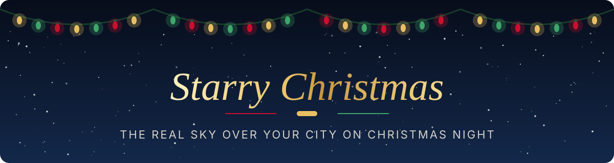
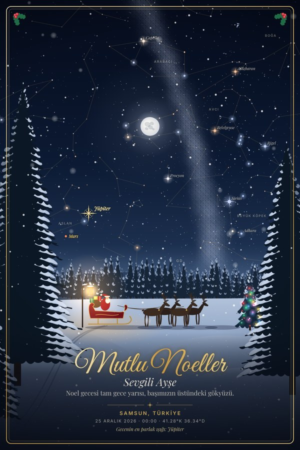
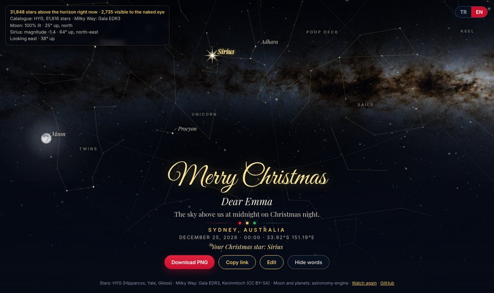
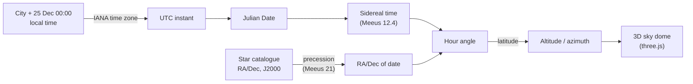

<p align="center">
  
</p>

<p align="center">
  <b>A Christmas card made of the real night sky over your city at midnight — every star where it really is, named.</b><br>
  <i>Şehrinin üzerindeki gerçek gökyüzü, Noel gecesi tam gece yarısı — her yıldız gerçek yerinde, adıyla.</i>
</p>

<p align="center">
  <a href="https://sayko89.github.io/starry-christmas/"></a>
  
  
  
  
</p>

<p align="center">
  <a href="https://sayko89.github.io/starry-christmas/"><b>Make a card</b></a> &nbsp;·&nbsp;
  <a href="#how-the-sky-is-computed">How it works</a> &nbsp;·&nbsp;
  <a href="#run-it-locally">Run it locally</a>
</p>

<br>

## The experience

<p align="center">
  
</p>

1. **A Christmas street.** The camera glides down a snowy street at night — lit shop windows, strings
   of lights across the road, lanterns, a crowd, reindeer made of lights, a giant tree — rises past the
   star on top of the tree and stops above the town.
2. **One line, four questions.** Over that same view: *"This Christmas, give them the sky."* Then who
   the card is for, which city, which night and a message, each question drifting down letter by
   letter like snow.
3. **The real sky.** The camera turns to the sky over that city at 00:00 on Christmas night (or New
   Year's Eve). Stars, planets, the Moon and the constellations are named; the brightest star or
   planet of the night is marked as **your Christmas star**; a panel shows the numbers behind it.
4. **The card.** The greeting is written underneath. Download it as a PNG or share a link.

<p align="center">
  
  &nbsp;
  
</p>

<br>

## What is on the screen

| | |
|---|---|
| **Stars** | 61,816 stars down to magnitude 8.5 from the HYG catalogue (Hipparcos, Yale, Gliese), each where it really is for that place and moment. A small shader draws them: brightness from magnitude, colour from temperature, dimmer, redder and twinklier near the horizon. |
| **Milky Way** | A rendering of the Galaxy made from ESA's Gaia EDR3, turned pixel by pixel from the local sky to galactic coordinates — so its dust lanes, the Orion Nebula and the Magellanic Clouds are where they really are that night. |
| **Moon and planets** | The Moon in its real phase, with its maria, Tycho and Copernicus, its lit side turned towards the Sun; Mercury to Saturn in their real places. |
| **Names and grid** | Bright stars, planets, the Moon and the main constellations are named, with gold constellation figures, a faint altitude/azimuth grid and compass points on the horizon. Names never overlap each other or the words. |
| **The numbers** | A panel shows how many stars are above the horizon and how many of them the eye can see, the Moon's phase and position, the Christmas star's magnitude and position, and where the camera looks. |
| **Framing** | The camera tries every direction and picks the one that shows the Christmas star, the Moon and the most Milky Way above the words, with a wide view (80°, 92° on phones). |
| **The opening** | A 3D Christmas town built entirely from code with [three.js](https://threejs.org): snowy roofs and chimneys, lit windows, slushy streets, pools of lantern light on the snow, a crowd in winter coats, a fir made of about 1,500 branches. Bloom makes the lights glow and switches itself off on slow phones. |
| **Sharing** | *Download PNG* (1200 × 1800, the sky, its names, the numbers and the words) and *Copy link*: every setting lives in the URL, and a shared link opens straight on the finished sky. *Edit* changes anything in place. |

Turkish and English throughout. With reduced motion turned on, the flight is skipped.

<p align="center">
  
</p>

<br>

## How the sky is computed

The astronomy is written from scratch in [`js/astro.js`](js/astro.js), following Jean Meeus,
*Astronomical Algorithms*:



1. **Local midnight to UTC.** `zonedTime()` uses the browser's time-zone database (`Intl`), so
   daylight-saving time is handled: midnight in Sydney on 25 December is 13:00 UTC the day before.
2. **Sidereal time.** Which part of the sky is overhead depends on the Earth's rotation relative to
   the stars, not the Sun.
3. **Precession.** Catalogue positions are for the year 2000; the Earth's axis wobbles, so they are
   moved to the date of the card (about a third of a degree by 2026).
4. **Altitude and azimuth** for the observer's latitude. Anything below the horizon is left out.
5. **Onto the sky.** Each altitude/azimuth becomes a direction in the 3D scene (north is down the
   street), seen as a person standing in the town would see it.

Star colours come from the B–V colour index, through temperature, to a blackbody colour. For the
Milky Way, the dome's shader runs the chain backwards for every pixel — altitude/azimuth to hour
angle and declination, to right ascension, to galactic longitude and latitude — and samples the Gaia
picture there. The Moon's phase and the planets come from
[Astronomy Engine](https://github.com/cosinekitty/astronomy).

### Tested against known answers

`npm test` (11 tests) checks the formulas against the worked examples in Meeus (sidereal time,
precession) and against Astronomy Engine, an independent full-precision library: for six bright stars
seen from Samsun, New York, Sydney and Tromsø, the positions agree to within **0.05°**, a tenth of the
Moon's width. It also checks that the packed 61,816-star file decodes correctly (Sirius first,
Betelgeuse red, Rigel blue).

<br>

## Project structure

| File | Purpose |
|---|---|
| [`index.html`](index.html), [`css/style.css`](css/style.css) | The page: 3D stage, questions, final screen, edit panel |
| [`js/astro.js`](js/astro.js) | Time zones, sidereal time, precession, altitude/azimuth, star colours |
| [`js/sky.js`](js/sky.js) | What is above the horizon from one place at one moment: stars, Moon, planets, galactic latitude |
| [`js/intro.js`](js/intro.js) | The 3D scene: the town, the real sky and its names, the camera, the PNG still |
| [`js/quiz.js`](js/quiz.js) | The welcome line and the four questions, with letters falling like snow |
| [`js/app.js`](js/app.js) | The flow, framing, data panel, edit panel, Turkish/English text, sharing |
| [`js/finale.js`](js/finale.js) | Draws the names, numbers and words onto the PNG |
| [`tools/build_data.py`](tools/build_data.py) | Builds `data/` from the open catalogues, including the packed `stars-deep.bin` |
| [`textures/`](textures) | The Gaia EDR3 Milky Way picture |
| [`tests/`](tests) | Astronomy and data tests (`node --test`) |

Plain HTML, CSS and JavaScript modules: no framework and no build step. The whole page — 3D scene,
61,816 stars (360 KB), the Milky Way picture (520 KB) and fonts — is about 2.3 MB.

<br>

## Run it locally

```bash
git clone https://github.com/sayko89/starry-christmas.git
cd starry-christmas
python3 -m http.server 8000      # then open http://localhost:8000
```

Run the tests (Node 20+):

```bash
npm install
npm test
```

Rebuild the data files from the original catalogues:

```bash
python3 tools/build_data.py path/to/d3-celestial/data path/to/city-timezones/data/cityMap.json path/to/HYG-Database/hyg/CURRENT/hygdata_v41.csv
```

<br>

## Ideas for later

- [ ] Any date and time, not only Christmas and New Year
- [ ] Deep-sky objects (nebulae, clusters) with names
- [ ] A short video of the flight to share

<br>

## Credits

Stars from the [HYG database](https://github.com/astronexus/HYG-Database) v4.1 (CC BY-SA 4.0);
the Milky Way from Kevinmloch's Gaia EDR3 rendering (ESA/Gaia/DPAC, CC BY-SA 4.0); star names and
constellations from [d3-celestial](https://github.com/ofrohn/d3-celestial) (BSD); cities from
[city-timezones](https://github.com/kevinroberts/city-timezones) (MIT); Moon and planets from
[Astronomy Engine](https://github.com/cosinekitty/astronomy) (MIT); 3D with [three.js](https://threejs.org)
(MIT); fonts Great Vibes, Playfair Display and Inter (SIL OFL). Details in [THIRD_PARTY.md](THIRD_PARTY.md).
Code: MIT.

<p align="center"><sub>Starry Christmas · Safiye Özkan · 2026</sub></p>
