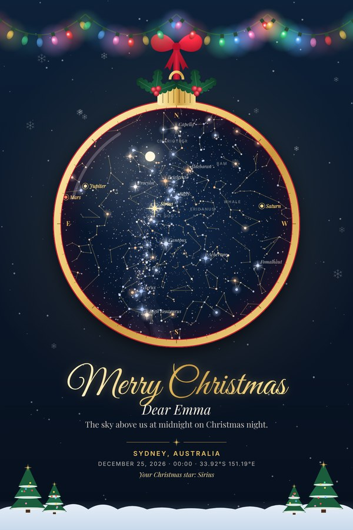
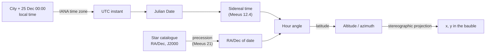

<h1 align="center">✨ Starry Christmas</h1>

<p align="center">
  <b>A Christmas card with the real night sky over your city at midnight — drawn inside a Christmas bauble.</b><br>
  <i>Şehrinin üzerindeki gerçek gökyüzü, Noel gecesi tam gece yarısı — bir yılbaşı süsünün içinde.</i>
</p>

<p align="center">
  <a href="https://sayko89.github.io/starry-christmas/"><b>▶ Make a card</b></a> &nbsp;·&nbsp;
  <a href="#how-the-sky-is-computed">How it works</a> &nbsp;·&nbsp;
  <a href="#run-it-locally">Run it locally</a>
</p>

<p align="center">
  
  &nbsp;
  
</p>

Pick a city, write a name and a message, and the page draws the sky exactly as it will be above that
city at **00:00 on Christmas night** (or on New Year's Eve): 5,000 stars with their real colours, the
constellations, the Milky Way, the Moon in its correct phase and the planets. The brightest star or
planet that night is marked as **your Christmas star**. Download the card as a PNG or share a link
that recreates it.

<br>

## What's on the card

| | |
|---|---|
| **The sky** | Every star to magnitude 6 (what the eye can see from a dark place), sized by brightness and coloured by temperature. Constellation figures in gold, Milky Way, Moon with its phase, Mercury to Saturn. |
| **The Christmas star** | The brightest star or planet more than 10° above the horizon gets a gold sparkle and a line on the card — Jupiter over Samsun in 2026, Sirius over Sydney. |
| **The bauble** | A glass Christmas ornament with a gold rim (with degree ticks and compass points), a gold cap, a red ribbon and bow, and holly. |
| **The lights** | A garland of bulbs across the top that twinkles in the preview (and stays still for people who prefer reduced motion). |
| **Your words** | Greeting, name and message; city, date, time and coordinates underneath. Turkish and English. |
| **Sharing** | *Download PNG* (1200 × 1800, ready to print at 4 × 6 in) and *Copy link* — every setting lives in the URL. |

<p align="center">
  
</p>

<br>

## How the sky is computed

The astronomy is written from scratch in [`js/astro.js`](js/astro.js) (no libraries), following
Jean Meeus, *Astronomical Algorithms*:



1. **Local midnight → UTC.** `zonedTime()` uses the browser's time-zone database (`Intl`), so
   daylight-saving time is handled — midnight in Sydney on 25 December is 13:00 UTC the day before.
2. **Sidereal time.** Which part of the sky is overhead depends on the Earth's rotation relative to
   the stars, not the Sun.
3. **Precession.** Catalogue positions are for the year 2000; the Earth's axis wobbles, so they are
   moved to the date of the card (about a third of a degree by 2026).
4. **Altitude and azimuth** for the observer's latitude. Anything below the horizon is left out.
5. **Stereographic projection** centred on the zenith, as if you were lying in the snow looking up:
   north at the top, **east on the left**. It keeps constellation shapes undistorted.

Star colours come from the B–V colour index → temperature → blackbody colour. The Moon (with its
phase) and the planets come from [Astronomy Engine](https://github.com/cosinekitty/astronomy).

### Tested against known answers

`npm test` checks the formulas against the worked examples in Meeus (sidereal time, precession)
and against Astronomy Engine, an independent full-precision library: for six bright stars, seen from
Samsun, New York, Sydney and Tromsø, our positions agree to within **0.05°** — a tenth of the Moon's
width.

<br>

## Project structure

| File | Purpose |
|---|---|
| [`index.html`](index.html), [`css/style.css`](css/style.css) | The page: preview and form |
| [`js/astro.js`](js/astro.js) | Time zones, sidereal time, precession, alt/az, projection, star colours |
| [`js/sky.js`](js/sky.js) | Turns the catalogues into what is visible from one place at one moment |
| [`js/card.js`](js/card.js) | Draws the card on a canvas: lights, bauble, sky, text, snow and trees |
| [`js/app.js`](js/app.js) | Form, Turkish/English text, URL sharing, PNG download, twinkling |
| [`tools/build_data.py`](tools/build_data.py) | Builds the small JSON files in `data/` from the open source catalogues |
| [`tests/`](tests) | Astronomy tests (`node --test`) |

Plain HTML, CSS and JavaScript modules — no framework and no build step. The whole page is under 1 MB,
including the star data and fonts.

<br>

## Run it locally

```bash
git clone https://github.com/sayko89/starry-christmas.git
cd starry-christmas
python3 -m http.server 8000      # then open http://localhost:8000
```

Run the tests (Node 20+):

```bash
npm install
npm test
```

Rebuild the data files from the original catalogues:

```bash
python3 tools/build_data.py path/to/d3-celestial/data path/to/city-timezones/data/cityMap.json
```

<br>

## Ideas for later

- [ ] Choose any date and time, not only Christmas and New Year
- [ ] More card themes (snow globe, wreath)
- [ ] Print-quality PDF export

<br>

## Credits

Star positions from the Hipparcos catalogue via [d3-celestial](https://github.com/ofrohn/d3-celestial)
(BSD), cities from [city-timezones](https://github.com/kevinroberts/city-timezones) (MIT), Moon and
planets from [Astronomy Engine](https://github.com/cosinekitty/astronomy) (MIT), fonts Great Vibes,
Playfair Display and Inter (SIL OFL). Details in [THIRD_PARTY.md](THIRD_PARTY.md). Code: MIT.

<p align="center"><sub>Starry Christmas · Safiye Özkan · 2026</sub></p>
