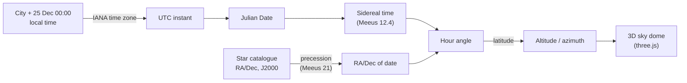

<h1 align="center">✨ Starry Christmas</h1>

<p align="center">
  <b>A Christmas card made of the real night sky over your city at midnight — every star where it really is, named.</b><br>
  <i>Şehrinin üzerindeki gerçek gökyüzü, Noel gecesi tam gece yarısı — her yıldız gerçek yerinde, adıyla.</i>
</p>

<p align="center">
  <a href="https://sayko89.github.io/starry-christmas/"><b>▶ Make a card</b></a> &nbsp;·&nbsp;
  <a href="#how-the-sky-is-computed">How it works</a> &nbsp;·&nbsp;
  <a href="#run-it-locally">Run it locally</a>
</p>

<p align="center">
  
</p>

The page opens with a short flight: the camera glides down a Christmas street at night — lit shop
windows, strings of lights across the road, lanterns, a crowd, reindeer made of lights and a giant
tree — then rises past the star on top of the tree, turns, and stops on one view: the lit street and
the snowy roofs of the town below, the stars above. The words appear over that same picture: one
line, *"This Christmas, give them the sky"*, then four questions — who the card is for, which city,
which night, and a message — each one drifting down letter by letter like snow.

Then the camera turns to **the real sky over that city at 00:00 on Christmas night** (or New Year's
Eve), computed from star catalogues: every star where it really is, with its real colour and
brightness, the constellations, the Milky Way, the Moon in its real phase and the planets. Their
names appear beside them, the brightest star or planet of the night is marked as **your Christmas
star**, and the greeting is written underneath.

<p align="center">
  
  &nbsp;
  
</p>

<br>

## What you get

| | |
|---|---|
| **The real sky** | 5,000 stars to magnitude 6, placed by altitude and azimuth for the chosen place and moment. Each is drawn by a small shader: brightness from its magnitude, colour from its temperature, dimmer and redder near the horizon, twinkling more there. The Moon has its real phase, turned so its lit side faces the Sun; the planets are where they really are; the Milky Way follows the real galactic plane. |
| **Names** | Bright stars, planets, the Moon and the main constellations are labelled beside them, with gold constellation figures; labels never overlap each other or the words. Both can be turned off. |
| **The Christmas star** | The brightest star or planet above 10° gets a gold sparkle, and the camera turns to frame it — Jupiter next to Regulus over Samsun in 2026, Sirius over Sydney. |
| **The opening** | A 3D scene built entirely from code with [three.js](https://threejs.org) — no models or images: snow-covered roofs and chimneys, lit windows with curtains and little trees, slushy streets with tyre tracks, pools of lantern light on the snow, a crowd in winter coats and hats, a fir made of ~1,500 branches, and a whole town of lit houses around it. Bloom and filmic tone mapping make the lights glow; if a phone struggles, the bloom switches itself off. The street runs north–south, so the sky above it is the real one from the start. *Skip* jumps ahead; with reduced motion turned on, the flight is skipped. |
| **Your words** | Greeting, name and message; city, date, time and coordinates underneath. Turkish and English. *Edit* opens a panel to change any of it — a new city or night turns the camera to the new sky. |
| **Sharing** | *Download PNG* (1200 × 1800, ready to print at 4 × 6 in: the sky, its names and the words) and *Copy link* — every setting lives in the URL, and a shared link opens straight on the finished sky. |

<p align="center">
  
</p>

<br>

## How the sky is computed

The astronomy is written from scratch in [`js/astro.js`](js/astro.js) (no libraries), following
Jean Meeus, *Astronomical Algorithms*:



1. **Local midnight → UTC.** `zonedTime()` uses the browser's time-zone database (`Intl`), so
   daylight-saving time is handled — midnight in Sydney on 25 December is 13:00 UTC the day before.
2. **Sidereal time.** Which part of the sky is overhead depends on the Earth's rotation relative to
   the stars, not the Sun.
3. **Precession.** Catalogue positions are for the year 2000; the Earth's axis wobbles, so they are
   moved to the date of the card (about a third of a degree by 2026).
4. **Altitude and azimuth** for the observer's latitude. Anything below the horizon is left out.
5. **Onto the sky.** Each altitude/azimuth becomes a direction in the 3D scene (north is down the
   street); the camera then looks at it like a person standing in the town would.

Star colours come from the B–V colour index → temperature → blackbody colour. The Moon (with its
phase) and the planets come from [Astronomy Engine](https://github.com/cosinekitty/astronomy).

### Tested against known answers

`npm test` (8 tests) checks the formulas against the worked examples in Meeus (sidereal time, precession)
and against Astronomy Engine, an independent full-precision library: for six bright stars, seen from
Samsun, New York, Sydney and Tromsø, our positions agree to within **0.05°** — a tenth of the Moon's
width.

<br>

## Project structure

| File | Purpose |
|---|---|
| [`index.html`](index.html), [`css/style.css`](css/style.css) | The page: 3D stage, questions, final screen, edit panel |
| [`js/astro.js`](js/astro.js) | Time zones, sidereal time, precession, alt/az, star colours |
| [`js/sky.js`](js/sky.js) | Turns the catalogues into what is above the horizon from one place at one moment, plus the Moon, planets and Milky Way |
| [`js/intro.js`](js/intro.js) | The 3D scene: Christmas street and town, the real sky with its labels, camera flight and turn, PNG still (three.js) |
| [`js/finale.js`](js/finale.js) | Draws the names and the words onto the PNG |
| [`js/quiz.js`](js/quiz.js) | Welcome line and the four questions, with letters falling like snow |
| [`js/app.js`](js/app.js) | The flow from the opening to the sky, edit panel, Turkish/English text, URL sharing, PNG download |
| [`tools/build_data.py`](tools/build_data.py) | Builds the small JSON files in `data/` from the open source catalogues |
| [`tests/`](tests) | Astronomy tests (`node --test`) |

Plain HTML, CSS and JavaScript modules — no framework and no build step. A shared link opens the
finished sky directly, without the opening. The whole page, with the 3D
scene, star data and fonts, is about 1.4 MB (around 350 KB compressed).

<br>

## Run it locally

```bash
git clone https://github.com/sayko89/starry-christmas.git
cd starry-christmas
python3 -m http.server 8000      # then open http://localhost:8000
```

Run the tests (Node 20+):

```bash
npm install
npm test
```

Rebuild the data files from the original catalogues:

```bash
python3 tools/build_data.py path/to/d3-celestial/data path/to/city-timezones/data/cityMap.json
```

<br>

## Ideas for later

- [ ] Choose any date and time, not only Christmas and New Year
- [ ] More card themes (snow globe, wreath)
- [ ] Print-quality PDF export

<br>

## Credits

Star positions from the Hipparcos catalogue via [d3-celestial](https://github.com/ofrohn/d3-celestial)
(BSD), cities from [city-timezones](https://github.com/kevinroberts/city-timezones) (MIT), Moon and
planets from [Astronomy Engine](https://github.com/cosinekitty/astronomy) (MIT), 3D with
[three.js](https://threejs.org) (MIT), fonts Great Vibes,
Playfair Display and Inter (SIL OFL). Details in [THIRD_PARTY.md](THIRD_PARTY.md). Code: MIT.

<p align="center"><sub>Starry Christmas · Safiye Özkan · 2026</sub></p>
